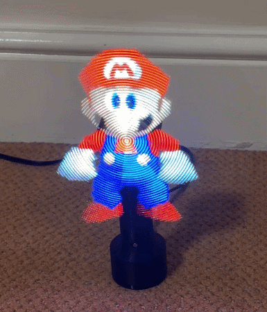
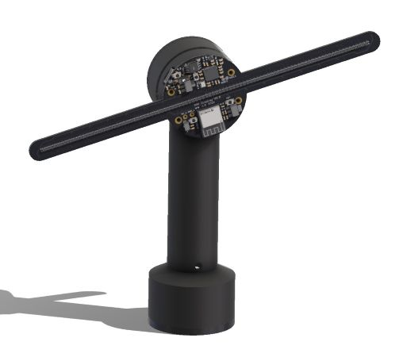

# POV Display V2

A spinning persistence of vision display showing images and animations. Two wings of RGB LEDs spin at high speed, and the image is drawn column by column synced with the rotation. Designed in Altium Designer and SolidWorks.

| Demo | Render |
|---|---|
|  |  |

## Features

- 96 RGB LEDs, 298 columns per revolution
- 8-bit colour depth per channel using binary code modulation
- Supports images and GIF animations, stored in flash for persistence
- Wi-Fi web interface for uploading images and GIFs and tuning colour calibration
- Hall-effect sensors for rotation sync and speed measurement

## How it works

The display is split into two parts:

- **Spinning PCB** – An RP2350 drives the LEDs through shift-register constant-current LED drivers using PIO and DMA, and uses hall-effect sensors to track angular position. An ESP32-C3 hosts the Wi-Fi web interface and passes images to the RP2350 over SPI. The board is powered wirelessly.
- **Base** – deliberately simple, contains the motor that spins the PCB and the wireless power transmitter. No data connections are needed between spinning PCB and base.

## Changes from V1

- Added an ESP32-C3 for wireless image upload
- LED drivers driven in parallel rather than daisy-chained, to remove data throughput bottlenecks, allowing for increased colour depth
- Added BOOTSEL and RESET buttons

## Repository

| Folder | Contents |
|---|---|
| [`docs/`](docs) | Schematics PDF, demo GIF and render |
| [`hardware/altium/`](hardware/altium) | Altium project (schematics, PCB, BOM) |
| [`hardware/fabrication/`](hardware/fabrication) | Gerbers and BOM |
| [`firmware/rp2350-display/`](firmware/rp2350-display) | Display firmware: LED driving, rotation sync, rendering |
| [`firmware/esp32-ui/`](firmware/esp32-ui) | Wi-Fi web interface and image converter |
| [`firmware/shared/`](firmware/shared) | Display geometry and SPI protocol shared by both MCUs |
| [`mechanical/`](mechanical) | SolidWorks files and STEP models of the base, mounts and PCB |

---

Jonathan Duncan, 2026
